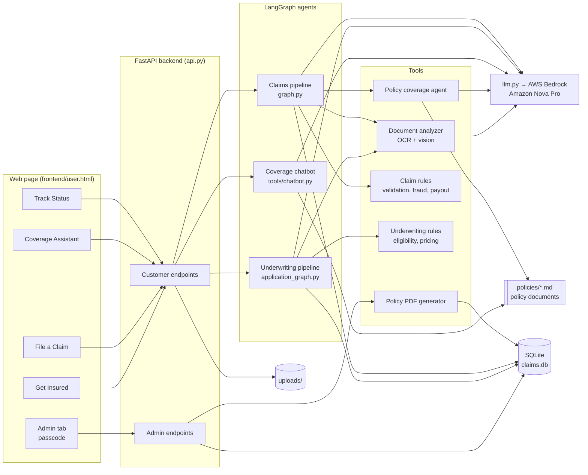
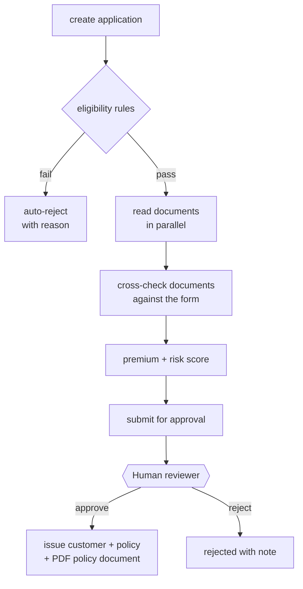
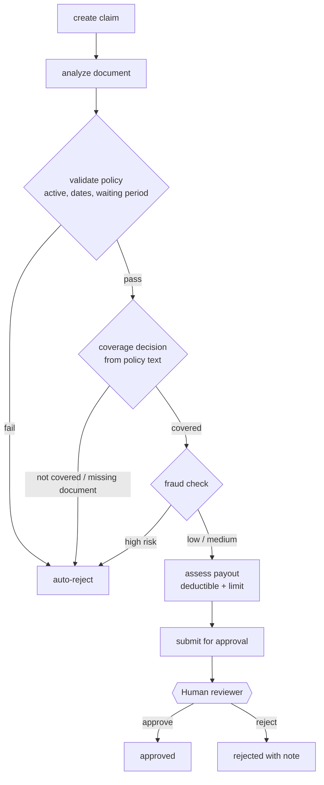

# Shield Insurance — Multi-Agent Insurance Platform

An agentic insurance system that handles the full customer journey: **apply for
insurance → get a policy → file a claim → get a decision**. AI agents do the
checking work (reading documents, validating against the policy, scoring fraud
and risk, pricing), and a **human reviewer makes every final decision**.

It started from the read-only Q&A chatbot in
[alphaiterations/multi-agent-system](https://github.com/alphaiterations/multi-agent-system)
and turns it into an action-taking system: it collects requests, analyses
uploaded documents, runs the whole process automatically and only hands
finished, checked work to a human for approval.

> **Demo system.** Customers, policies, premiums and bonus rates are sample
> data and illustrative figures. It is not a real insurer.

---

## Features

| Area | What it does |
|---|---|
| **Apply for insurance** | Auto, home, health and life products. Plan term and yearly/monthly payment, live premium quote, life-plan maturity projection, document upload. |
| **Underwriting agent** | Eligibility rules, reads every uploaded document, cross-checks it against the form (name, date of birth, vehicle number, income), risk score, premium. |
| **Policy issuance** | Admin approval creates the customer and an active policy, with a downloadable **PDF policy document** (schedule, benefits, payment schedule). |
| **File a claim** | Asks for the right document per incident (e.g. theft → police complaint), reads it, validates against the policy, checks coverage against the policy text, scores fraud, assesses the payout. |
| **Coverage assistant** | Chatbot that answers "am I covered?" questions from the customer's own policy document only. |
| **Tracking** | Customers track applications (`APL-…`) and claims (`TRK-…`) with their registered email. |
| **Admin desk** | Passcode-protected tab to review applications and claims with the agent's findings and the uploaded documents, then approve or reject. |
| **Document reading** | Text PDFs, scanned PDFs and photos (OCR + vision model). |

---

## Models used

| Purpose | Model | Where |
|---|---|---|
| All language and vision tasks (document reading, field extraction, coverage reasoning, chatbot, reviewer notes) | **Amazon Nova Pro** on **AWS Bedrock** — model ID `us.amazon.nova-pro-v1:0` | `llm.py` |
| Optional alternative provider | OpenAI (`gpt-4o-mini` by default), via `LLM_PROVIDER=openai` | `llm.py` |
| OCR (text from images and scans) | **Tesseract 5** via `pytesseract` | `tools/document_analyzer.py` |
| Rendering scanned PDF pages | `pypdfium2` | `tools/document_analyzer.py` |

Every model call goes through one module, `llm.py`, using the Bedrock
**Converse API** (text and images). Switching provider or model is a `.env`
change, not a code change.

**The model never makes the final decision.** Eligibility, coverage limits,
deductibles, fraud scores and payouts are calculated by deterministic rules so
every outcome is explainable. The model reads documents, explains its
reasoning and drafts notes. If the model is unavailable, the app keeps working
on its rule-based fallbacks (OCR text, policy rules, keyword matching) instead
of failing.

---

## Architecture



### Stage 1 — Underwriting pipeline (`application_graph.py`)



### Stage 2 — Claims pipeline (`graph.py`)



---

## The agents

| Agent / node | File | Role |
|---|---|---|
| **Underwriting pipeline** | `application_graph.py` | LangGraph state machine for new applications: create → eligibility → read documents → cross-check → price → submit. |
| **Eligibility & pricing rules** | `underwriting_rules.py` | Products, form fields, required documents, age/vehicle/coverage rules, premium factors, term and payment schedule, life maturity projection. |
| **Claims pipeline** | `graph.py` | LangGraph state machine for claims: create → analyze document → validate → coverage → fraud → assess → submit. |
| **Document analyzer** | `tools/document_analyzer.py` | Detects PDF / scan / image, runs OCR and the vision model, extracts structured fields. |
| **Policy coverage agent** | `tools/policy_agent.py` | Reads the policy document for the claim's policy type and decides covered / not covered, citing the clause. Enforces the required-document rule. |
| **Claim rules** | `tools/claim_tools.py` | Policy validation (status, dates, health waiting period), rule-based fraud scoring, payout after deductible and limit. |
| **Coverage chatbot** | `tools/chatbot.py` | Answers customer questions from their own policy document only. |
| **Policy rules** | `policy_rules.py` | Which incident types each policy covers and which document each needs. |
| **Policy PDF** | `policy_pdf.py` | Generates the downloadable policy document. |
| **Model layer** | `llm.py` | One place for all model calls (Bedrock Nova Pro, or OpenAI), with JSON mode, image input and a short-lived failure cache. |

### Products and rules

| Product | Terms | Asks for | Documents | Hard rules |
|---|---|---|---|---|
| Auto | 1–3 years | Vehicle number, make/model, year | ID proof, vehicle registration, driving licence | Age 18+, vehicle ≤ 15 years |
| Home | 1, 3, 5 years | Address, type, year built, value | ID proof, ownership document | Coverage ≤ property value, built 1900+ |
| Health | 1–3 years | Height, weight, smoker, conditions | ID proof, medical declaration | Age 18–65; 30-day waiting period (emergencies covered from day one) |
| Life (savings plan) | 10–30 years | Occupation, income, smoker, nominee | ID proof, income proof | Age 18–60, coverage ≤ 10× income, age at end of term ≤ 75 |

Document mismatches (for example a registration showing a different vehicle
number) do **not** auto-reject. They raise the risk level and are listed for the
reviewer, who decides.

### Statuses

| Status | Meaning |
|---|---|
| `pending_approval` | Passed all automated checks, waiting for a human |
| `approved` | Approved by a human (for applications, a policy is issued) |
| `rejected` | Rejected by a human, with a note to the customer |
| `rejected_auto` | Failed a hard rule; never reaches a human |

---

## Tech stack

| Layer | Technology |
|---|---|
| Agent orchestration | LangGraph |
| Models | AWS Bedrock — Amazon Nova Pro (Converse API, text + vision) |
| OCR / PDF | Tesseract (pytesseract), pypdf, pypdfium2 |
| Backend | FastAPI, Uvicorn |
| Frontend | Single HTML page, vanilla JavaScript and CSS (no build step) |
| Database | SQLite |
| Policy PDF | ReportLab |

---

## Project layout

```
claim-intake-agent/
├── api.py                  FastAPI app: customer + admin endpoints, serves the page
├── application_graph.py    LangGraph underwriting pipeline (stage 1)
├── graph.py                LangGraph claims pipeline (stage 2)
├── llm.py                  Model layer (Bedrock Nova Pro / OpenAI)
├── underwriting_rules.py   Products, eligibility, pricing, terms, projections
├── policy_rules.py         Incident → covered? → required document
├── policy_pdf.py           Policy document PDF generator
├── database.py             SQLite schema and data access
├── seed_data.py            Sample customers, policies and coverage rules
├── config.py               Settings loaded from .env
├── tools/
│   ├── document_analyzer.py
│   ├── policy_agent.py
│   ├── claim_tools.py
│   └── chatbot.py
├── policies/               Policy documents the agents read (auto, home, health, life)
├── frontend/user.html      The whole web app, including the Admin tab
├── sample_docs/            Sample documents for testing claims
├── uploads/                Uploaded files (not committed)
├── requirements.txt
└── .env.example
```

---

## Setup

Requires **Python 3.10+** (developed on 3.12).

```bash
# 1. Install dependencies
python -m pip install -r requirements.txt

# 2. Configure: copy the example and fill in your AWS credentials
cp .env.example .env          # Windows: copy .env.example .env

# 3. Create the database with sample customers and policies
python seed_data.py

# 4. Start the server (serves both the API and the web page)
python -m uvicorn api:app --host 127.0.0.1 --port 8000
```

Open <http://127.0.0.1:8000>.

### Configuration (`.env`)

| Variable | Purpose |
|---|---|
| `LLM_PROVIDER` | `bedrock` (default) or `openai` |
| `AWS_ACCESS_KEY_ID`, `AWS_SECRET_ACCESS_KEY` | IAM user with Bedrock access (or use `AWS_PROFILE`) |
| `AWS_REGION` | e.g. `us-east-1` |
| `BEDROCK_MODEL_ID`, `BEDROCK_VISION_MODEL_ID` | Default `us.amazon.nova-pro-v1:0` |
| `OPENAI_API_KEY` | Only if `LLM_PROVIDER=openai` |
| `ADMIN_TOKEN` | Admin passcode. Defaults to `admin123` — **change it** before sharing the app |
| `TESSERACT_CMD` | Only if Tesseract is installed somewhere unusual |

**AWS Bedrock access:** the IAM user needs Bedrock invoke permission (for
example `AmazonBedrockFullAccess` while testing), and the account must be
allowed to use the model in that region. Amazon Nova models do not need the
Anthropic use-case form.

**OCR:** install Tesseract for scanned documents and photos. On Windows:
`winget install UB-Mannheim.TesseractOCR`. The app finds it automatically.

---

## Using it

| Screen | Link | How |
|---|---|---|
| Get Insured | `/` | Pick a product, fill in details, choose term and payment, see the live quote, upload documents. You get an `APL-` ID. |
| File a Claim | `/#/file` | Policy number + registered email, incident, amount and the required document. You get a `TRK-` ID. |
| Coverage Assistant | `/#/chat` | Policy number + email, then ask in plain words. |
| Track Status | `/#/track` | Email + `APL-`/`TRK-` ID, or email + policy number for all claims. Approved applications show the policy number and a PDF download. |
| Admin | `/#/admin` (or `/admin`) | Sign in with the passcode, review applications or claims, approve or reject. |

### Test data

`python seed_data.py` prints sample policies with their owner's email.
Running it again **resets** the sample data. Example:

- Policy `POL000004`, email `user4@example.com` (active auto policy)
- Sample documents in `sample_docs/`: car damage photo, repair estimate,
  police complaint (FIR), medical certificate

---

## Security notes

- `.env`, the database and uploaded files are excluded from Git.
- Customers can only see their own applications and claims (policy number +
  registered email); a wrong pair gets the same "not found" reply as a missing
  record, so the app never reveals that someone else's policy exists.
- All text shown in the page is escaped, so customer input or document text
  cannot inject HTML.
- Uploads are limited to PDFs and images up to 10 MB and stored under random
  names. Admin document downloads only serve files recorded on a claim or
  application.
- The admin passcode is a single shared secret, suitable for a demo. For real
  use, replace it with proper staff accounts.

---

## Roadmap

- Host on AWS (Bedrock AgentCore Runtime / container), with uploads in S3 and
  the database on a managed service instead of SQLite.
- Proper staff accounts instead of a shared passcode.
- Email notifications when an application or claim is decided.
